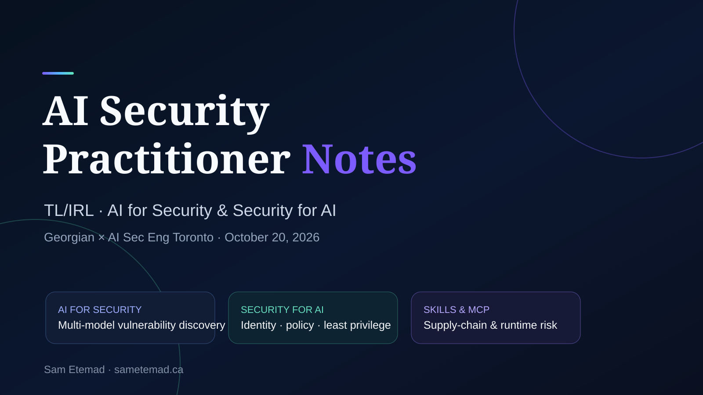
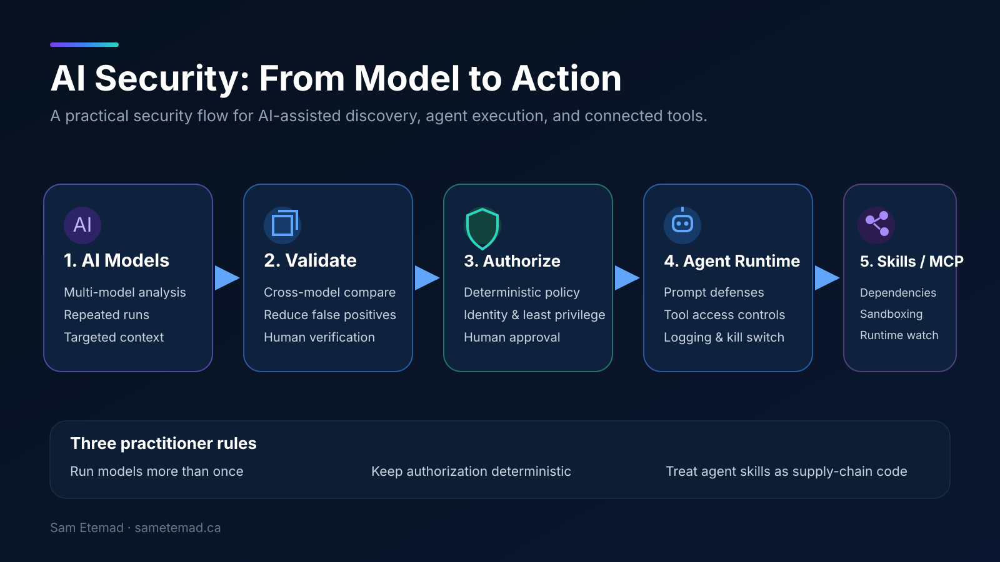

# AI Security Practitioner Notes

Technical notes and practitioner takeaways from **TL/IRL: AI for Security & Security for AI**, hosted by **Georgian × AI Sec Eng Toronto** in Toronto on **October 20, 2026**.

This repository documents my personal technical notes, observations, and security takeaways from the event. It does **not** reproduce the speakers' research, code, slides, or proprietary materials, and it should not be interpreted as an independent replication of the presented benchmarks.

## Event Focus

1. **AI for Security** — multi-model vulnerability discovery, repeated runs, validation, context engineering, and cost per confirmed finding.
2. **Security for AI Agents** — prompt injection, identity, deterministic authorization, trust boundaries, human approval, observability, and kill switches.
3. **Agent Skills & MCP Supply Chain Security** — skills, scripts, tools, MCP connections, dependencies, sandboxing, and runtime monitoring.

## Security Flow

## Key Practitioner Takeaways

- One model and one run are not enough for serious AI-assisted vulnerability discovery.
- Different models can find different vulnerability classes, so multi-model coverage matters.
- Prompt engineering and targeted context can materially affect security-analysis performance.
- More context is not automatically better context.
- Prompt injection should be treated as an integrity risk, not a solved problem.
- AI agents should have identities and permissions distinct from the humans they act for.
- Authorization should remain deterministic and outside the LLM.
- Human approval is most valuable for irreversible or high-impact actions.
- Agent systems need kill switches, graceful failure states, auditability, and human handoff.
- Agent Skills and MCP-connected tools should be treated as a software supply-chain surface.

## Repository Structure

- [Event Overview](docs/event-overview.md)
- [AI for Security](docs/ai-for-security.md)
- [Production Agent Security](docs/agent-security.md)
- [Agent Skills & MCP Security](docs/agent-skills-security.md)
- [Key Takeaways](docs/key-takeaways.md)
- [Portfolio Follow-On Ideas](docs/portfolio-ideas.md)

## Disclaimer

Figures and benchmark results referenced in these notes are recorded as **speaker-presented results** from the event. They are not my own benchmark results unless explicitly stated otherwise.

## Author

**Sam Etemad**  
IT Systems & Security Specialist  
https://sametemad.ca
